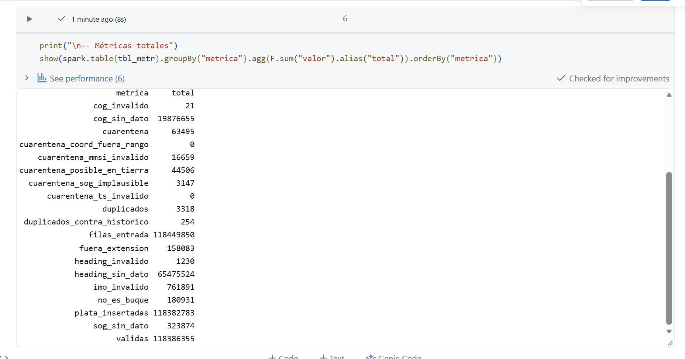
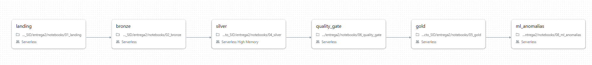
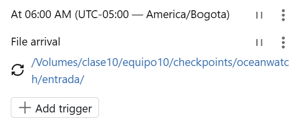
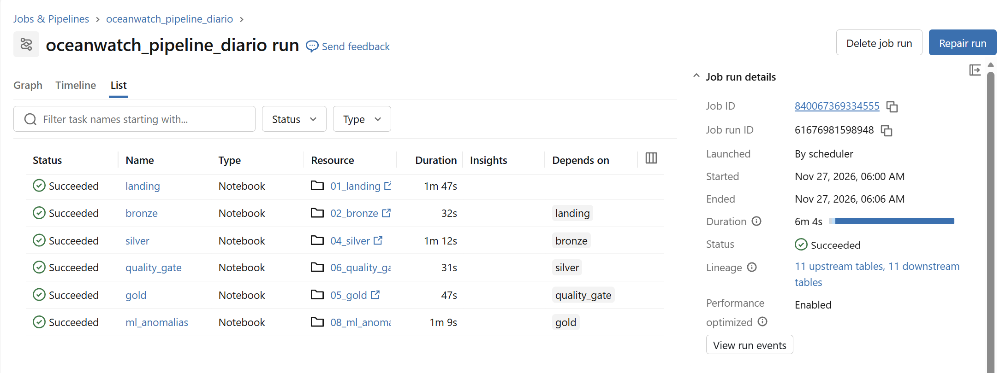
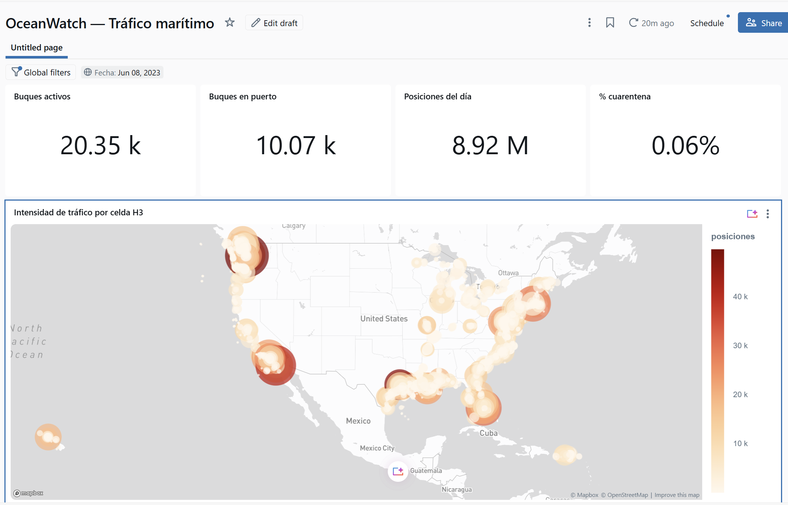
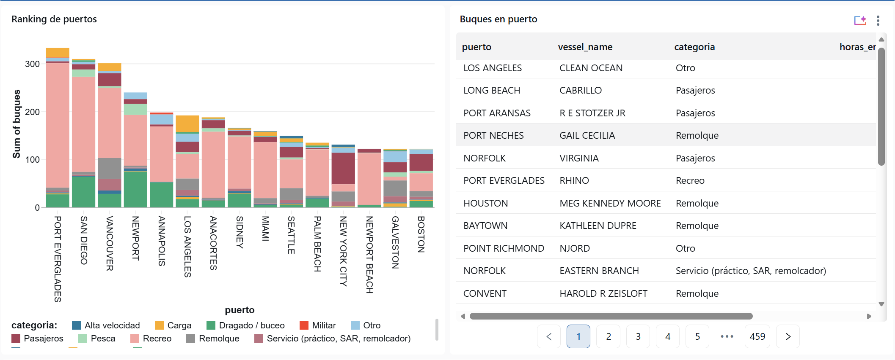
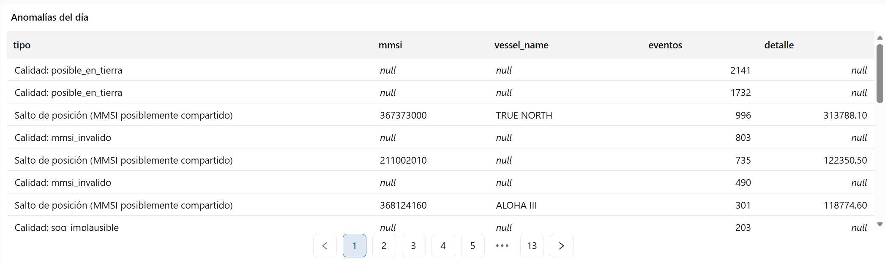
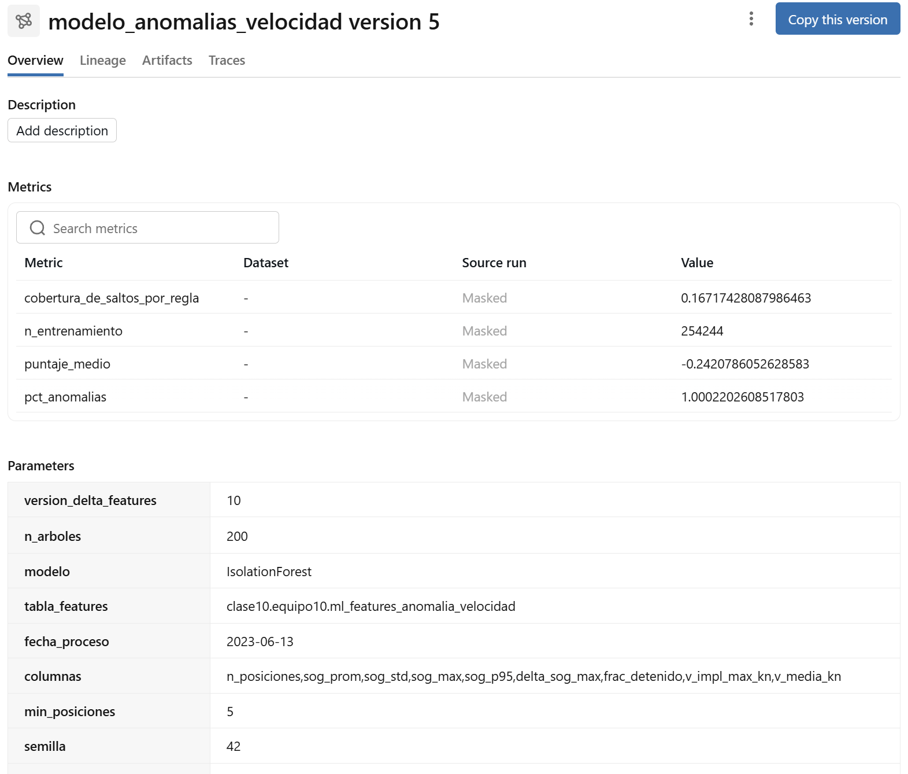
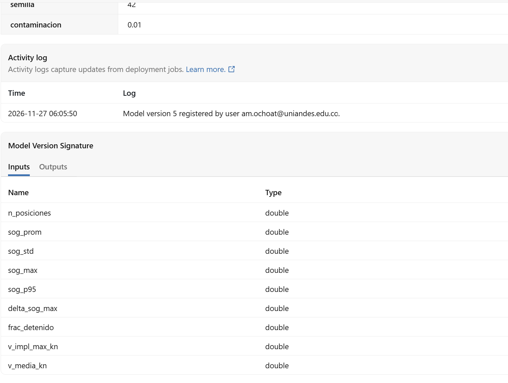
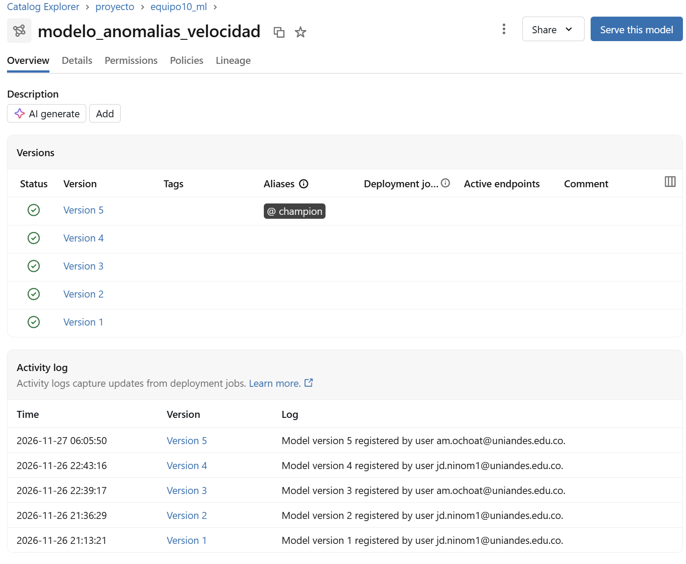

# OceanWatch Analytics · Entrega 2 · Pipeline diario

**Proyecto Final Entrega 2 | MINE4213 | Universidad de los Andes**

Pipeline diario de ingeniería de datos sobre posiciones AIS de buques (NOAA Marine Cadastre): ingesta en streaming, capas bronce, plata y oro con calidad como compuerta, orquestación, tablero, gobernanza y un modelo de detección de anomalías con MLflow.

---

## Descripción

```
NOAA (zip diario) → landing → bronce → plata → compuerta de calidad → oro → tablero
                                          ↓                            ↓
                                     cuarentena + métricas        modelo de anomalías (MLflow)
```

- **Fuente:** AIS Data de Marine Cadastre (NOAA), un zip por día con un CSV de posiciones.
- **Periodo procesado:** 1 al 12 de junio de 2023 (12 días, y el job suma uno más en cada ejecución).
- **Plataforma:** Databricks, Unity Catalog, Delta Lake.
- **Dónde vive:** catálogo `clase10`, esquema `equipo10`. Las tablas llevan el prefijo de su capa (`bronze_`, `silver_`, `gold_`, `ops_`, `ml_`).

---

## Puntos de la Entrega

### Punto 1: Ingesta en streaming (15 %)
- `01_landing` descarga el zip del día y deja el CSV completo en el volume que vigila Auto Loader. Es idempotente.
- `02_bronze` lee con Auto Loader (`cloudFiles`), guarda todo como texto (crudo, inmutable) y agrega el archivo de origen y la hora de ingesta. El checkpoint garantiza que cada archivo se procese una sola vez.
- **Duplicados:** en plata se elimina uno por buque y timestamp, y un `MERGE` que solo inserta evita repetir registros ya cargados.
- **Tolerancia a fallos:** `02b_demo_falla` inyecta una falla al procesar un archivo, relanza con el mismo checkpoint y concilia las filas de bronce contra las líneas de los CSV.

### Punto 2: Capas con calidad como compuerta (15 %)
- **Bronce:** crudo, sin transformar.
- **Plata** (`04_silver`): aplica las compuertas de calidad. Un registro va a **cuarentena**, con su causa, si el MMSI está mal formado, la fecha es inválida, las coordenadas están fuera de rango, la posición cae en tierra (máscara H3 de `03_land_mask`) o la velocidad supera 50 nudos. Otros problemas (rumbo, IMO, valores "sin dato") quedan como marcas sin descartar el registro. Todo se resume en la tabla de métricas `ops_calidad_metricas`.
- **Compuerta** (`06_quality_gate`): detiene el pipeline si la cuarentena del día supera 1 %, si no hay filas de entrada o si plata queda vacía. Cada evaluación queda en `ops_quality_gate_log`.
- **Oro** (`05_gold`): `gold_trafico_celda_hora` (matriz de tráfico por celda H3 y hora), `gold_trayectorias_diarias` (recorrido de cada buque por día), `gold_presencia_puertos` (buques detenidos a menos de 5 km de un puerto) y `gold_dim_tipo_buque`.
- Un registro no llega a oro si no pasa las compuertas.

**Evidencia:** salida de `04_silver` con la conciliación (bronce = plata + cuarentena + duplicados) y la cuarentena por causa.



### Punto 3: Orquestación (20 %)
Job `oceanwatch_pipeline_diario`, con seis tareas encadenadas:

`landing → bronze → silver → quality_gate → gold → ml_anomalias`

- **Parámetros:** `fecha_feed` (`auto` toma el día siguiente al último cargado). La fecha resuelta en `landing` se pasa a las demás tareas.
- **Reintentos:** landing 3, bronce 2, plata 2, oro 1, ML 1.
- **Monitoreo:** alerta si una tarea supera su duración esperada, tiempos máximos por tarea y correo si el job falla.
- **Ejecución programada:** todos los días a las 6:00 a. m. (hora de Bogotá), y también cuando llegan archivos nuevos al volume de entrada.
- La definición completa está en `entrega2/jobs/oceanwatch_pipeline_diario.yml`.

**Evidencia:** las seis tareas con sus dependencias.



El schedule configurado.



Una corrida terminada correctamente.



### Punto 4: Consola de visualización (15 %)
Tablero **OceanWatch — Tráfico marítimo**, alimentado por la capa oro y las métricas de calidad:
- Indicadores del día: buques activos, buques en puerto, posiciones y % de cuarentena.
- Mapa de intensidad de tráfico por celda H3.
- Ranking de puertos (top 15 por buques) con filtro por categoría de buque.
- Buques en puerto y anomalías del día (calidad y saltos de posición).
- Filtro por fecha.

**Evidencia:** el tablero publicado con una fecha elegida.

  

  



### Punto 5: Gobernanza (10 %)
Tres roles (ingenieros, científicos de datos y analistas) con permisos por tabla, contrato de datos de la capa oro y linaje de Unity Catalog.
- [docs/gobernanza.md](docs/gobernanza.md): permisos, quién tiene cada rol, cómo se aplicó y evidencia.
- [docs/contrato_datos_oro.md](docs/contrato_datos_oro.md): contrato de las cuatro tablas de oro.
- Notebook `07_gobernanza`.

### Punto 6: ML con MLflow (10 %)
Detección de anomalías de velocidad (`08_ml_anomalias`):
- **Características** por buque y día: velocidad promedio, desviación, máxima, percentil 95, cambio brusco de velocidad, fracción detenido y velocidad implícita.
- **Modelo:** Isolation Forest con semilla fija y 1 % de anomalías esperadas.
- **MLflow:** el experimento registra parámetros, métricas y la versión de los datos. El modelo queda registrado en Unity Catalog como `proyecto.equipo10_ml.modelo_anomalias_velocidad`, con el alias `champion`.
- **Salida:** `ml_anomalias_velocidad`, con los buques atípicos de cada día. Corre como última tarea del job.
- El objetivo es demostrar ML dentro de un pipeline reproducible, no maximizar la precisión.

**Evidencia:** la versión 5 del modelo (alias `champion`), con los parámetros y métricas registrados en MLflow y la firma de entrada.





El modelo registrado en Unity Catalog, con sus versiones y el alias `champion`.



**Cómo leer el resultado.** El modelo marca el 1 % de buque-días con el perfil de velocidad más atípico. Coincide con solo el 16,7 % de los saltos detectados por regla, porque la regla detecta errores de posición y el modelo detecta comportamiento de velocidad: son señales complementarias. Los casos más extremos del modelo son lanchas rápidas de recreo y de fuerza pública, con 45 a 49 nudos y sin saltos de posición: atípicas pero plausibles. Sin etiquetas no se puede validar cuáles son errores y cuáles son comportamiento real.

### Punto 7: Repositorio y bitácora (5 %)
- Código en `entrega2/notebooks`, definición del job en `entrega2/jobs` y tablero en `entrega2/dashboards`.
- Bitácora de la entrega: [bitacora.md](bitacora.md).

---

## Resultados principales

- **Datos procesados:** 12 días (1 al 12 de junio de 2023), con entre 7,8 y 9,1 millones de posiciones de entrada por día.
- **Calidad:** la cuarentena fue de entre 0,033 % y 0,073 % de las filas por día, muy por debajo del umbral de 1 %. La compuerta dio OK en los 12 días.
- **Oro:** entre 19.500 y 21.700 buques por día en las trayectorias diarias.
- **ML:** 254.244 buque-días puntuados con la misma versión del modelo (versión 5), de los cuales el 1 % queda marcado como atípico.

---

## Notebooks

| Notebook | Qué hace |
|---|---|
| `00_config` | Detecta el workspace y arma los nombres de tablas y volúmenes |
| `00_setup` | Crea la estructura (esquemas y volúmenes) |
| `01_landing` | Descarga el zip del día |
| `02_bronze` | Auto Loader hacia bronce |
| `02b_demo_falla` | Demostración de tolerancia a fallos |
| `02c_profiling_bronze` | Perfilamiento de la capa cruda |
| `03_land_mask` | Marca las celdas H3 que son tierra |
| `04_silver` | Compuertas de calidad, cuarentena y métricas |
| `05_gold` | Tablas de oro |
| `06_quality_gate` | Corta el pipeline si la calidad no alcanza |
| `07_gobernanza` | Permisos por rol y contrato de datos |
| `08_ml_anomalias` | Modelo de anomalías con MLflow |

## Cómo ejecutar

1. **Una sola vez:** `00_setup` (estructura), `03_land_mask` (máscara de tierra) y `07_gobernanza` (permisos y contrato).
2. **Cada día:** el job `oceanwatch_pipeline_diario`, que descarga el día siguiente y recorre las seis tareas. También se puede lanzar a mano.
3. Los notebooks usan `00_config`, así que corren igual en el workspace del curso (`clase10.equipo10`) y en uno propio (`oceanwatch_e2`).


## Fuentes de datos

- **AIS Data, Marine Cadastre (NOAA):** https://hub.marinecadastre.gov/pages/vesseltraffic
- **World Port Index:** catálogo de puertos del mismo dataset.
- **Máscara de tierra:** Natural Earth (`ne_10m_land`, lagos y ríos).

## Autores

Manuela Galarza - Joel David Niño - Andres Ochoa

---

Última actualización: 27 de Noviembre de 2026
